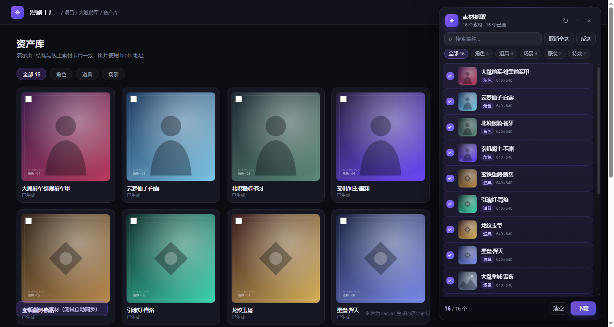

# 漫剧素材抓取（AI Comic Asset Grabber）

一个跑在 Chromium 内核浏览器里的素材抓取扩展：扫描漫剧平台的资产卡片，在页面右侧面板里展示「图片 + 名称」，多选后按文件夹批量下载。

- 适配 QQ 浏览器（极速模式）、Chrome、Edge
- 不需要服务器，不上传数据，图片只在本机处理
- 只对 `yinghuo.clouded.top`（含任意端口）注入，其它网站不生效



## 功能

| 能力 | 说明 |
| --- | --- |
| 自动扫描 | 识别 `article.asset-card`，名称取 `<strong>` / `img[alt]`，图片取 `img` |
| 深度扫描 | 同源 iframe、开放 Shadow DOM 内的卡片也能扫到 |
| 只显示已生成 | 没有图片的「未生图」卡片直接跳过 |
| 多选 | 单击勾选、`Shift` 连选、全选 / 反选 / 清空 |
| 搜索与分类 | 按名称搜索，按类型（角色 / 道具 / 场景…）筛选 |
| 批量下载 | 输入文件夹名，下载到 `下载/<文件夹>/<素材名称>.png` |
| 可拖动 | 按住标题栏拖动，位置记忆；双击复位 |
| 实时同步 | 只显示当前 DOM 里的卡片；卡片移除后列表和选中状态一起移除 |
| 格式识别 | png / jpg / webp / gif / avif，按 MIME + 文件头判断 |

## 快速安装（非技术用户）

1. 下载 [release/qq-mv3.zip](release/qq-mv3.zip)
2. 右键解压到桌面，得到 `qq-mv3` 文件夹
3. QQ 浏览器地址栏打开 `qqbrowser://extensions`
4. 打开「开发者模式」→「加载已解压的扩展程序」→ 选 `qq-mv3`
5. **浏览器设置 → 下载设置 → 取消勾选「每次下载前询问保存位置」**
6. 打开平台页面，刷新，右侧出现面板

> 图文版：[安装教程 Word](docs/素材抓取插件-安装教程.docx) ｜ [PDF](docs/素材抓取插件-安装教程.pdf)  
> 如果 QQ 提示「清单版本不支持」，改用 [release/qq-mv2.zip](release/qq-mv2.zip)。

> 只支持「极速模式」（Chromium 内核）；兼容模式（IE 内核）下扩展不会注入。

## 使用

1. 打开平台资产库页面，面板会自动出现在右侧（没有就点工具栏插件图标）
2. 勾选素材，或点「全选」
3. 点「下载」，输入文件夹名称
4. 点「开始下载」，文件落在浏览器下载目录下的同名文件夹

面板只展示当前已渲染的卡片；滚动加载的新卡片会自动加入，滚出 DOM 的会被移除。

## 开发

要求 Node.js >= 22（E2E 使用内置 `WebSocket`）。

```bash
node test/unit.mjs     # 12 项纯逻辑单测
node build.mjs         # 生成 dist/qq-mv3 和 dist/qq-mv2
```

端到端测试（无 Playwright 依赖，直接用 CDP）：

```powershell
$env:CHROME_PATH = "C:\Program Files\Google\Chrome\Application\chrome.exe"
$env:E2E_EXT_DIR = "dist/qq-mv3"
node test/e2e.mjs
```

> Chrome 137+ 正式版禁用了命令行加载未打包扩展，自动测试请用 Chrome for Testing 或 Edge；手动「加载已解压」不受影响。

### 目录

```
src/                 扩展源码（lib / content / background / 两份 manifest）
demo/                本地演示页与 127.0.0.1:6912 静态服务器
test/                单测 + CDP 端到端测试
tools/               图标生成、安装文档生成脚本
docs/                安装教程、截图
release/             可直接分发的 zip
build.mjs            构建脚本（无依赖）
```

### 发布包

`build.mjs` 只生成 `dist/`，不会打 zip。发布时：

```powershell
Compress-Archive -Path "dist\qq-mv3\*" -DestinationPath "release\qq-mv3.zip" -Force
Compress-Archive -Path "dist\qq-mv2\*" -DestinationPath "release\qq-mv2.zip" -Force
```

zip 根目录必须直接包含 `manifest.json`。

## 已知限制

- 抓取的是页面渲染的 **640 宽预览图**，不是平台原图。
- 只扫描当前已渲染的 DOM，不支持预抓虚拟列表全量。
- 跨域 iframe 不支持（同源 iframe 支持）。
- 不是浏览器原生侧边栏，是页面内浮层，切换标签页不跟随。
- QQ 浏览器未实机验证；如遇问题请附上 QQ 版本与页面截图。
- Firefox / Safari 未实现。

## 文档

- [AI 开发交接文档](AI开发交接文档.md)：架构、决策、坑、测试与修改指南（交给 AI Agent 前先读）
- [安装教程 DOCX](docs/素材抓取插件-安装教程.docx) / [PDF](docs/素材抓取插件-安装教程.pdf)
- [更新日志](CHANGELOG.md) ｜ [贡献说明](CONTRIBUTING.md)

## 许可证

[MIT](LICENSE) © 2026 sj7510

